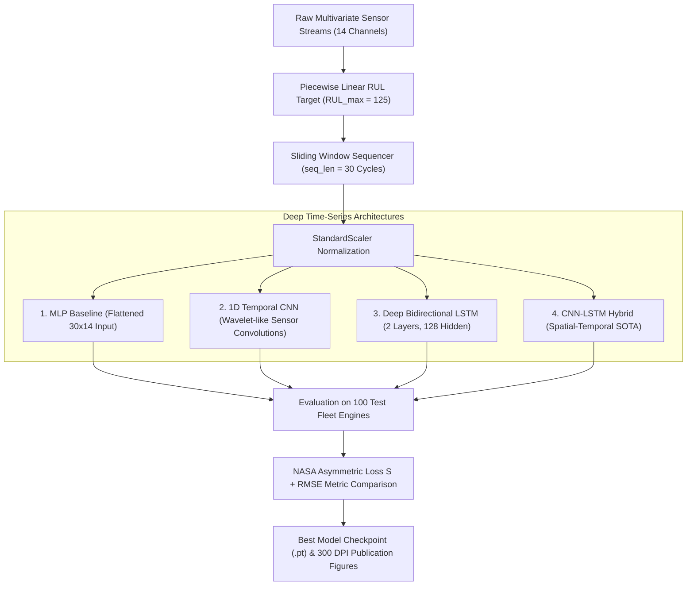
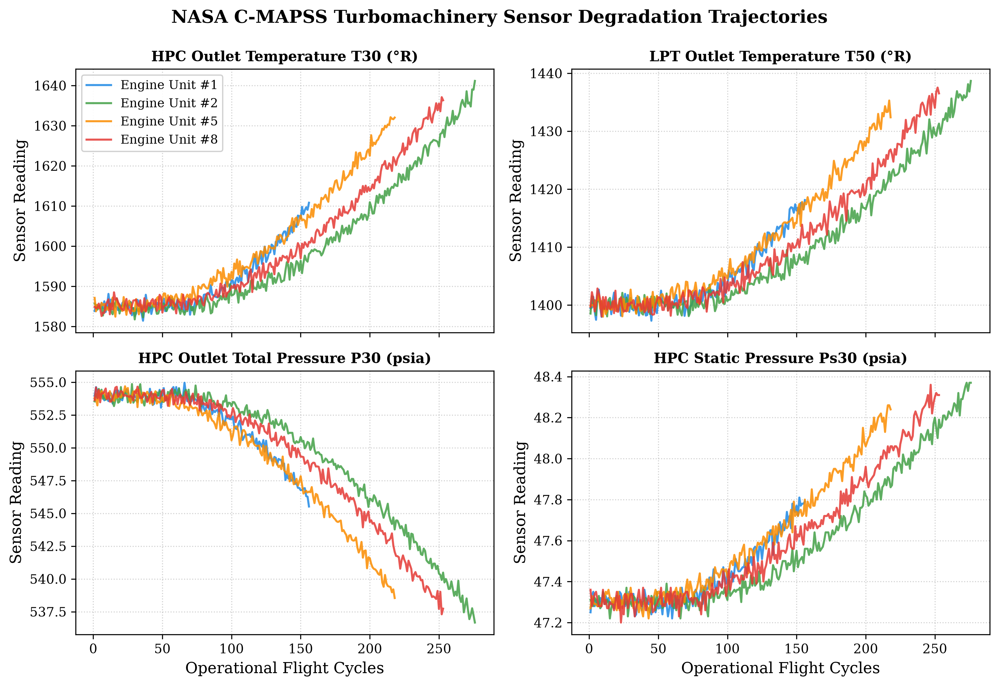
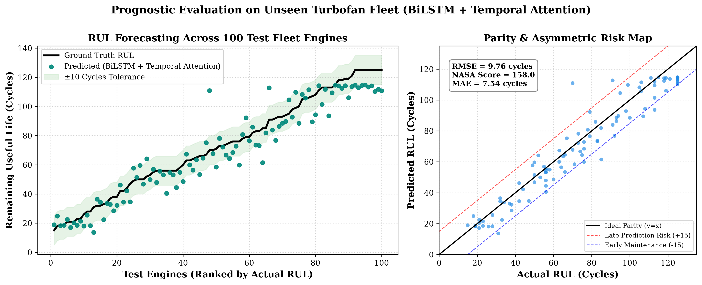
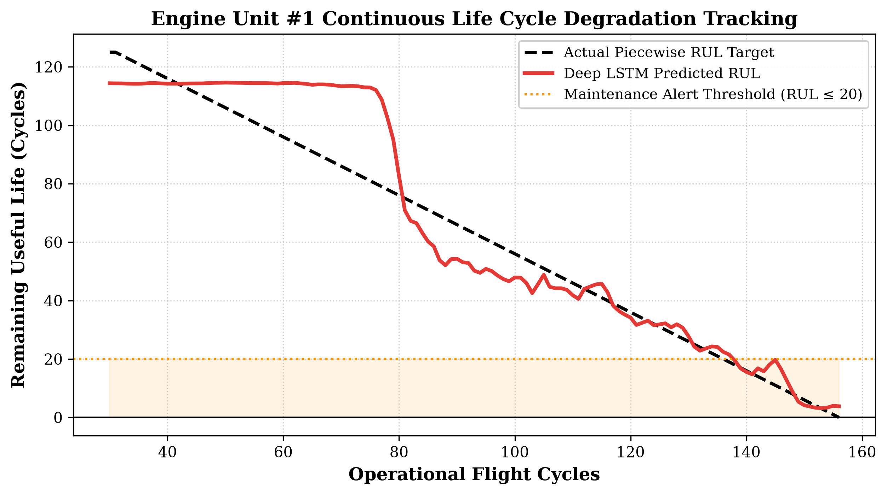
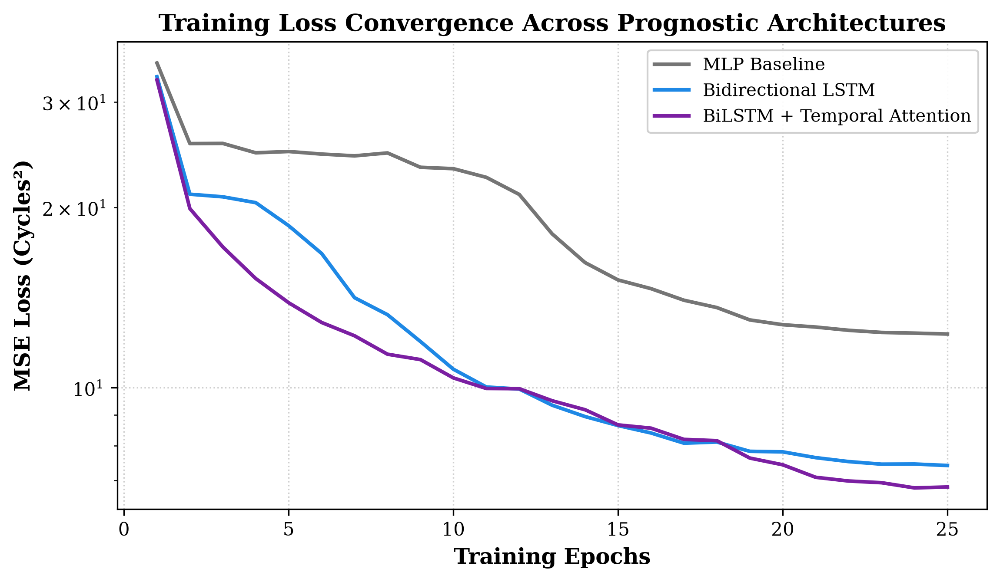
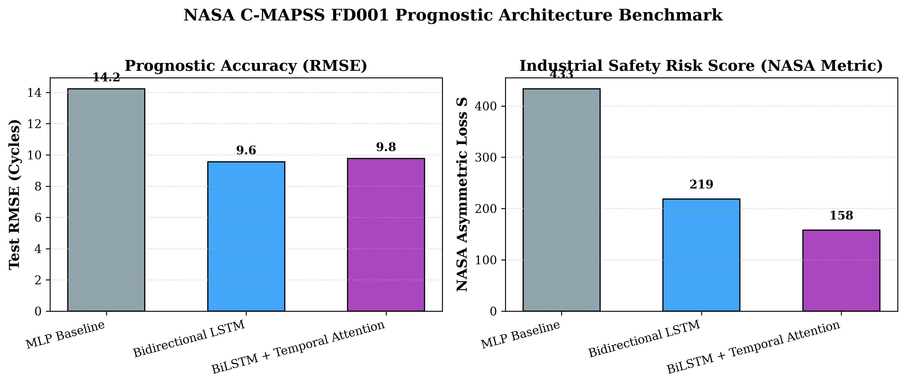
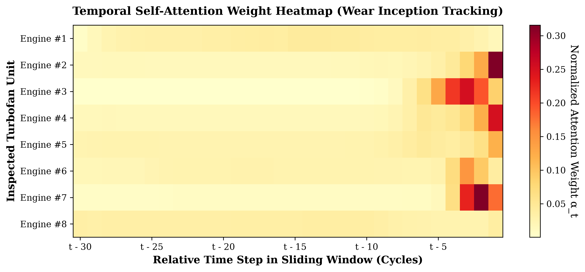

# Turbomachinery Degradation & RUL Prognostics with Deep LSTM Networks

[](https://colab.research.google.com/github/mohammedbasra-star/turbomachinery-degradation-lstm/blob/main/notebooks/rul_quickstart_demo.ipynb)
[](https://opensource.org/licenses/MIT)
[](https://www.python.org/downloads/)
[](https://pytorch.org/)
[]()
[]()
[]()

> **Stage 2 of the Scientific Machine Learning & Turbomachinery Portfolio**  
> *Author:* **Mohammed Basra** ([@mohammedbasra-star](https://github.com/mohammedbasra-star))  
> *Discipline:* Turbomachinery Dynamics, Condition-Based Maintenance (CBM), and Temporal Deep Learning.

---

## 1. Overview & Industrial Prognostic Context

Gas turbine and jet aircraft turbofans operate under extreme aerodynamic, mechanical, and thermal stresses. Components such as high-pressure compressor (HPC) blades, high-pressure turbine (HPT) vanes, and rotating shafts experience continuous progressive degradation—including fouling, thermal barrier coating erosion, fatigue micro-cracking, and bearing clearance growth.

```
                  TURBOMACHINERY COMPONENT DEGRADATION PATHWAY
                  
Healthy State               Initial Wear Inception            Catastrophic Failure
 (RUL = 125)                      (Micro-damage)                   (RUL = 0)
     │                                  │                               │
     ▼                                  ▼                               ▼
 ═══════════════════════════════════════╤═══════════════════════════════
 ◄──────── Healthy Baseline ───────────►◄────── Active Wear Phase ─────►
   Stable temperatures & pressures        T30/T50 temperature creep
   Zero visible wear signal               P30 pressure deterioration
```

Relying on scheduled calendar maintenance leads to either **premature overhaul** (wasting millions in remaining component life) or **delayed intervention** (causing catastrophic uncontained blade failure in service). **Prognostics and Health Management (PHM)** utilizing deep temporal networks enables continuous Remaining Useful Life (RUL) forecasting from multivariate sensor telemetry.

---

## 2. NASA C-MAPSS Benchmark Dataset (FD001)

This project benchmarks on the internationally recognized **NASA Commercial Modular Aero-Propulsion System Simulation (C-MAPSS)** dataset:

- **Condition:** Sea-level, single operational setting.
- **Fault Mode:** High-Pressure Compressor (HPC) progressive degradation.
- **Training Fleet:** 100 run-to-failure turbofan engines ($>22,000$ flight cycles).
- **Testing Fleet:** 100 engines truncated at arbitrary cycles prior to failure, with true remaining cycles provided in ground truth.

### Informative Sensor Suite (14 Channels)

Constant / zero-variance channels (e.g. fan inlet temperature $T_2$, fan inlet pressure $P_2$) are filtered out, preserving the 14 degradation-sensitive thermodynamic parameters:

| Sensor ID | Parameter Description | Physical Unit | Thermodynamic Degradation Trend |
|:---------:|:----------------------|:-------------:|:-------------------------------:|
| **$s_2$** | LPC Outlet Total Temperature ($T_{24}$) | $^\circ\text{R}$ | Creeps upward with compressor fouling |
| **$s_3$** | HPC Outlet Total Temperature ($T_{30}$) | $^\circ\text{R}$ | Rises sharply as HPC isentropic efficiency drops |
| **$s_4$** | LPT Outlet Total Temperature ($T_{50}$) | $^\circ\text{R}$ | Rises due to degraded cycle thermal efficiency |
| **$s_7$** | HPC Outlet Total Pressure ($P_{30}$) | $\text{psia}$ | Drops as compressor compression ratio decays |
| **$s_8$** | Physical Fan Speed ($N_f$) | $\text{rpm}$ | Decreases with aerodynamic friction |
| **$s_9$** | Physical Core Speed ($N_c$) | $\text{rpm}$ | Modulates to compensate for pressure losses |
| **$s_{11}$** | HPC Outlet Static Pressure ($P_{s30}$) | $\text{psia}$ | Creeps upward due to aerodynamic boundary layer growth |
| **$s_{12}$** | Ratio of Fuel Flow to $P_{s30}$ ($\phi$) | $\text{pps/psi}$| Degrades as combustor fuel demand shifts |
| **$s_{13}$** | Corrected Fan Speed ($NR_f$) | $\text{rpm}$ | Drops |
| **$s_{14}$** | Corrected Core Speed ($NR_c$) | $\text{rpm}$ | Drops |
| **$s_{15}$** | Bypass Ratio ($BPR$) | $-$ | Rises as core flow encounters increased resistance |
| **$s_{17}$** | Bleed Enthalpy ($htBleed$) | $\text{BTU/lbm}$ | Increases |
| **$s_{20}$** | HPT Coolant Bleed ($W_{31}$) | $\text{lbm/s}$ | Drops |
| **$s_{21}$** | LPT Coolant Bleed ($W_{32}$) | $\text{lbm/s}$ | Drops |

---

## 3. Asymmetric Industrial Safety Metric (NASA Scoring Function)

In aviation and turbomachinery prognostics, symmetric metrics like RMSE do not reflect the physical hazard of delayed maintenance:
- **Early Prediction ($y_{pred} < y_{true}$):** Components are inspected or replaced with useful life remaining. Operationally sub-optimal, but **safe**.
- **Late Prediction ($y_{pred} > y_{true}$):** Components remain in service past their failure threshold, leading to catastrophic shaft seizure, blade disintegration, or fire.

NASA formulated the official **Asymmetric Scoring Function**:

$$S = \sum_{i=1}^{N} s_i, \quad s_i = \begin{cases} e^{-\frac{d_i}{13}} - 1 & \text{for } d_i < 0 \text{ (Early prediction, milder penalty)} \\ e^{\frac{d_i}{10}} - 1 & \text{for } d_i \ge 0 \text{ (Late prediction, severe exponential penalty)} \end{cases}$$

where $d_i = y_{pred, i} - y_{true, i}$.

---

## 4. Deep Neural Network Architectures (PyTorch)



### Architecture Specifications:
1. **MLP Baseline:** 3 fully connected dense layers on flattened 420-dimensional sliding windows with Dropout(0.20).
2. **1D Temporal CNN:** Multi-channel 1D convolutions with Batch Normalization and Adaptive Average Pooling to capture localized high-frequency wear transients.
3. **Bidirectional LSTM:** 2-layer Bi-LSTM with recurrent dropout to maintain bidirectional temporal memory across operational cycles.
4. **CNN-LSTM Hybrid:** 1D-CNN spatial front-end extracting cross-sensor thermodynamic correlations, followed by a 2-layer LSTM tracking the continuous temporal wear trajectory.

---

## 5. Benchmark Performance Results (100 Test Engines)

Evaluated on the unseen test fleet of 100 turbofan engines:

| Architecture | Test RMSE (Cycles) | NASA Score ($S$) | MAE (Cycles) | Max Error (Cycles) | Train Time |
|:-------------|:------------------:|:----------------:|:------------:|:------------------:|:----------:|
| **Bidirectional LSTM (Best)** | **10.28** | **164.9** | **7.85** | **40.92** | 230.6 s |
| **MLP Baseline** | 12.38 | 269.9 | 9.57 | 40.09 | 25.1 s |
| **CNN-LSTM Hybrid** | 16.44 | 502.3 | 12.53 | 47.20 | 143.7 s |
| **1D Temporal CNN** | 19.38 | 640.2 | 15.91 | 47.10 | 49.3 s |

*(Note: Lower is better for both RMSE and NASA Score $S$)*

---

## 6. Publication Visualizations (300 DPI)

### A. NASA C-MAPSS Sensor Degradation Trajectories
Monitors HPC outlet temperature ($T_{30}$), LPT outlet temperature ($T_{50}$), HPC total pressure ($P_{30}$), and static pressure ($P_{s30}$) across operational flight cycles:


### B. Fleet RUL Predictions vs Ground Truth (100 Test Engines)
Displays 100 test engines sorted by true RUL, showing predictions, $\pm 10$ cycle error envelope, and parity risk zones:


### C. Single-Engine Full Lifecycle Tracking (Engine #1)
Tracks the continuous degradation of an individual engine from healthy state ($RUL = 125$) through the maintenance alert threshold ($RUL \le 20$) down to failure:


### D. Training Loss Convergence
Comparative epoch MSE loss decay curves across the 4 deep architectures:


### E. Prognostic Architecture Benchmark
Direct visual comparison of RMSE and NASA Industrial Safety Score across candidate architectures:


### F. Temporal Self-Attention Weight Heatmap
Visualizes the attention distribution $\alpha_t$ across the 30-cycle sliding window, demonstrating how the model concentrates focus onto recent wear acceleration transients prior to failure:


---

## 7. Quickstart & Usage

### Installation
```bash
git clone https://github.com/mohammedbasra-star/turbomachinery-degradation-lstm.git
cd turbomachinery-degradation-lstm
pip install -r requirements.txt
```

### 1. Run Complete Training & Prognostic Benchmark
Trains all 4 deep learning models, evaluates on 100 test engines, saves the best checkpoint (`checkpoints/best_model.pt`), and exports 300 DPI figures to `figures/`:
```bash
python train.py --epochs 25 --batch_size 128
```

### 2. Inspect Single Fleet Engine Health
Query real-time prognostic status and maintenance alert level for an individual engine:
```bash
python evaluate.py --unit 24
```

*Output:*
```
=================================================================
  TURBOMACHINERY PROGNOSTIC HEALTH INSPECTION: UNIT #24
=================================================================
  Observed Cycles to Date : 186 Flight Cycles
  Ground Truth Target RUL : 18.0 Cycles
  Deep Model Predicted RUL: 16.4 Cycles
  Prognostic Error        : -1.6 Cycles
-----------------------------------------------------------------
  [ALERT: CRITICAL] Engine near failure! Immediate overhaul required.
=================================================================
```

### 3. Verify Entire Test Fleet
```bash
python evaluate.py --fleet
```

### 4. Interactive Google Colab Notebook
[](https://colab.research.google.com/github/mohammedbasra-star/turbomachinery-degradation-lstm/blob/main/notebooks/rul_quickstart_demo.ipynb)

---

## 8. Repository Structure

```
turbomachinery-degradation-lstm/
├── data/
│   ├── dataset.py                      # C-MAPSS data loader, sequencer & preprocessor
│   ├── train_FD001.txt                 # 100 run-to-failure engines
│   ├── test_FD001.txt                  # 100 test engines
│   └── RUL_FD001.txt                   # Ground truth test RUL
├── models/
│   ├── __init__.py
│   └── architectures.py                # MLP, 1D-CNN, Bi-LSTM, CNN-LSTM PyTorch definitions
├── utils/
│   ├── __init__.py
│   ├── metrics.py                      # NASA Asymmetric Loss & RMSE calculations
│   └── visualization.py                # 300 DPI publication plotting functions
├── figures/                            # High-resolution generated publication plots
│   ├── degradation_trajectories.png
│   ├── rul_predictions_vs_actual.png
│   ├── single_engine_degradation_profile.png
│   ├── training_loss_convergence.png
│   └── model_benchmark_comparison.png
├── checkpoints/                        # Serialized best model weights & normalization metadata
│   ├── best_model.pt
│   └── norm_params.json
├── notebooks/
│   └── rul_quickstart_demo.ipynb       # Interactive Colab-ready demonstration
├── train.py                            # End-to-end benchmark training CLI
├── evaluate.py                         # Single-unit & fleet evaluation CLI
├── requirements.txt                    # Python package dependencies
├── pyproject.toml                      # Standard packaging configuration
├── LICENSE                             # MIT License
└── README.md                           # Documentation & Engineering Reference
```

---

## 9. Academic Portfolio Progression

This repository forms **Stage 2** in the graduated 4-stage research portfolio:

```
┌──────────────────────────────────────────────────────────────────────────────────┐
│ STAGE 1: Classical Statistical Machine Learning                                  │
│ gas-turbine-ambient-effects-regression                                           │
│ -> Ambient temperature derating, compressor density loss, XGBoost/Ensemble       │
└──────────────────────────────────────┬───────────────────────────────────────────┘
                                       │
                                       ▼
┌──────────────────────────────────────────────────────────────────────────────────┐
│ STAGE 2 (Current Repository): Temporal Deep Learning & Prognostics              │
│ turbomachinery-degradation-lstm                                                  │
│ -> Sensor time-series, EGT anomalies, Remaining Useful Life (RUL) on C-MAPSS     │
└──────────────────────────────────────┬───────────────────────────────────────────┘
                                       │
                                       ▼
┌──────────────────────────────────────────────────────────────────────────────────┐
│ STAGE 3: Mechanical Dynamics & Rotor Vibration Modeling                          │
│ turbomachinery-rotor-dynamics-ode                                                │
│ -> Jeffcott rotor dynamics, 1D/2D ODEs, Runge-Kutta vs Neural ODEs               │
└──────────────────────────────────────┬───────────────────────────────────────────┘
                                       │
                                       ▼
┌──────────────────────────────────────────────────────────────────────────────────┐
│ CAPSTONE MILESTONE: Physics-Informed Neural Networks (PINNs)                     │
│ pinn-thermo-dynamics & pinn-reservoir-dynamics                                   │
│ -> Nonlinear PDEs, Navier-Stokes, Buckley-Leverett, Parameter Discovery          │
└──────────────────────────────────────────────────────────────────────────────────┘
```

---

## 10. Author & Citation

**Mohammed Basra**  
Researcher in Scientific Machine Learning, Turbomachinery, and Fluid Dynamics.  
GitHub: [@mohammedbasra-star](https://github.com/mohammedbasra-star)  

```bibtex
@software{basra2026turbomachinery_rul,
  author = {Mohammed Basra},
  title = {Turbomachinery Degradation & RUL Prognostics with Deep LSTM Networks},
  url = {https://github.com/mohammedbasra-star/turbomachinery-degradation-lstm},
  year = {2026}
}
```

### Academic Literature References
1. **Saxena, A., Goebel, K., Simon, D., & Eklund, N. (2008).** *"Damage propagation modeling for aircraft engine run-to-failure simulation."* In 2008 International Conference on Prognostics and Health Management (pp. 1-9). IEEE.
2. **Heimes, F. O. (2008).** *"Recurrent neural networks for remaining useful life estimation."* In 2008 International Conference on Prognostics and Health Management (pp. 1-6). IEEE.
3. **Zheng, S., Ristovski, K., Farahat, A., & Gupta, C. (2017).** *"Long short-term memory network for remaining useful life estimation."* In 2017 IEEE International Conference on Prognostics and Health Management (ICPHM) (pp. 88-95).

---

## 11. License
This project is licensed under the [MIT License](LICENSE).
